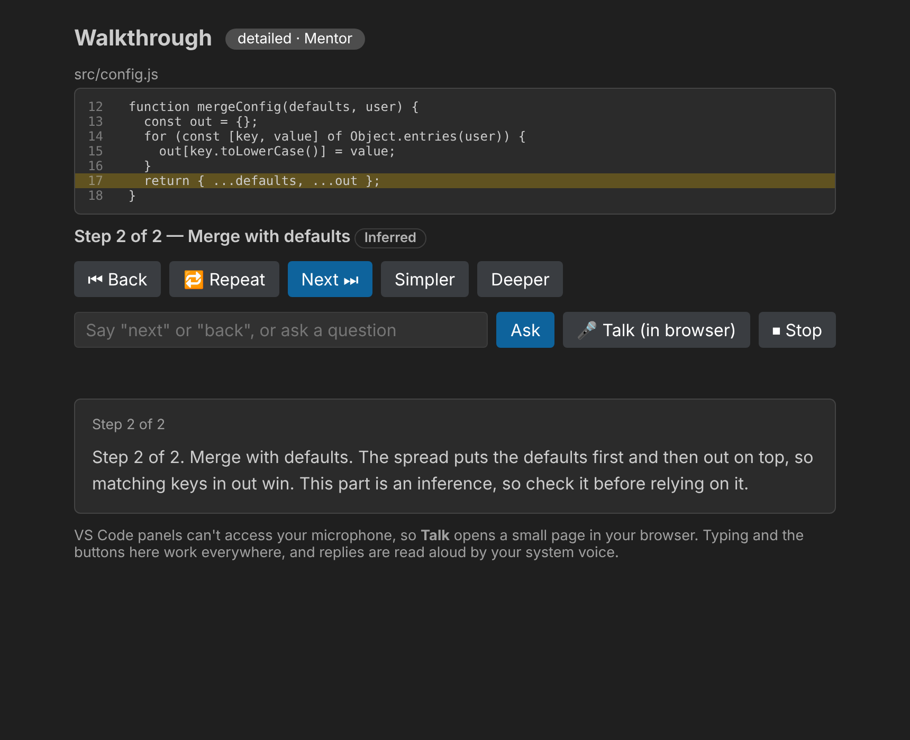
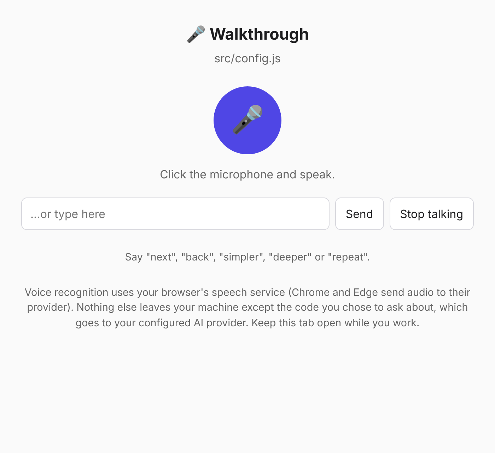

# Code Whisperer Voice

Select code in VS Code, say (or type) what you want, and hear it explained.



- **Explain, optimize, find bugs, document, write tests, security review**: by voice, by typing, or by clicking a card.
- **Three vibes**: Casual, Mentor, Professional.
- **Bring your own model**: OpenAI, Anthropic, [Ollama](https://ollama.com) (fully local, no key, your code never leaves your machine), or any OpenAI-compatible server (LM Studio, llama.cpp, vLLM…).
- **Reads answers aloud** with your system voice. No extra services, no extra cost.
- **Step-by-step walkthrough**: a guided, spoken tour of any selection. See [below](#walk-through-code-step-by-step).
- No runtime dependencies. MIT licensed.

## Install

**From source** (until it is on the Marketplace):

```bash
git clone https://github.com/manuaishika/code-whisperer
cd code-whisperer
npm ci
npm run package        # builds code-whisperer-voice-<version>.vsix
code --install-extension code-whisperer-voice-*.vsix
```

Then pick a model. The quickest options:

| You want | Settings |
|---|---|
| Fully local | `codeWhispererVoice.provider: "ollama"` (and `ollama pull llama3.1`) |
| OpenAI | `provider: "openai"`, then run **Code Whisperer: Set API Key** |
| Anthropic | `provider: "anthropic"`, then run **Code Whisperer: Set API Key** |
| LM Studio / llama.cpp / vLLM | `provider: "openai-compatible"`, `baseUrl: "http://localhost:1234/v1"` |

API keys are kept in VS Code's encrypted secret storage, never in `settings.json`. The environment variables `OPENAI_API_KEY` and `ANTHROPIC_API_KEY` are also honoured.

## Use

1. Select some code, right-click → **Explain Selected Code (Voice Mode)** (or run it from the Command Palette).
2. Pick a vibe.
3. Ask:
   - **Type** in the box, or click a command card, or
   - click **🎤 Talk (in browser)** and speak.

Things you can say: *"explain this"*, *"find bugs"*, *"optimize this"*, *"document this"*, *"write tests"*, *"check security"*. Phrasing is flexible: *"what are the security risks here?"* is a security review.

### Why does voice open in a browser?

VS Code panels can't access the microphone. So **Talk** opens a small page on `127.0.0.1` in Chrome, Edge or Safari, where the Web Speech API works. It sends what you said to the extension, and the page reads the answer aloud. In Codespaces and Remote-SSH the port is forwarded automatically.



Privacy notes:
- Speech recognition in Chrome and Edge is done by the browser vendor's cloud service. If that matters to you, use typing, which needs no microphone.
- The only other thing that leaves your machine is the code you selected, sent to the model provider you configured (nothing at all with Ollama).
- The local voice server listens on loopback only, requires a random per-session token and rejects requests from other websites.

### Replies read aloud

Replies use your system voice: `say` on macOS, SAPI on Windows, `spd-say` or `espeak-ng` on Linux (install one if you hear nothing). Turn it off or change the speed in settings (`speech.enabled`, `speech.rate`). **Code Whisperer: Stop Speaking** interrupts.

## Walk through code step by step

Select code and run **Code Whisperer: Walk Through Selected Code (Step by Step)**. It plans a short tour of the selection (an overview plus up to 12 ordered steps), reads the overview aloud, and waits for you to steer:

| Say (or click) | Does |
|---|---|
| "next" / "back" / "repeat" | Move between steps. The editor highlights that step's lines |
| "simpler" / "deeper" | Switch between one plain sentence, a detailed explanation, and a deep one that adds *why* it is built that way and what to watch for |
| any question | Answered from the code and the step you are on. If the code doesn't say, it tells you instead of guessing |
| "stop" | Ends the walkthrough |

**It tells you how it knows.** Each step is labelled *Read in code* (the selected code states it) or *Inferred* (it depends on code you didn't select, or is a reasoned guess). Inferred steps say so out loud: "This part is an inference, so check it before relying on it."

The model's plan is validated before anything is spoken: line ranges are clamped to your selection, only those two labels are accepted (anything unclear is treated as *Inferred*), and a malformed reply gives a clear error instead of garbage.

## Settings

| Setting | Default | |
|---|---|---|
| `codeWhispererVoice.provider` | `openai` | `openai`, `anthropic`, `ollama`, `openai-compatible` |
| `codeWhispererVoice.model` | provider default | `gpt-4o-mini`, `claude-sonnet-5-5`, `llama3.1` |
| `codeWhispererVoice.baseUrl` | provider default | required for `openai-compatible` |
| `codeWhispererVoice.maxTokens` | 700 | reply length cap |
| `codeWhispererVoice.defaultVibe` | Ask each time | or `Casual` / `Mentor` / `Professional` |
| `codeWhispererVoice.speech.enabled` / `.rate` | true / 1 | |
| `codeWhispererVoice.walkthrough.depth` | `detailed` | `simple`, `detailed`, `deep` |

## Troubleshooting

- **Nothing is spoken**: install `espeak-ng` or `speech-dispatcher` on Linux; check `speech.enabled`.
- **The Talk page says the mic is blocked**: allow microphone access for `127.0.0.1` in the address bar. Firefox has no speech recognition; use Chrome, Edge or Safari, or type.
- **"No API key"**: run **Code Whisperer: Set API Key**, or use `ollama`.
- **"Could not build a walkthrough"**: the model returned something that was not a usable plan. Try again, select a smaller piece of code, or use a stronger model (small local models sometimes break the JSON format).

## Development

```bash
npm ci
npm test            # compiles, then runs the unit tests (node:test, no VS Code needed)
npm run watch       # then press F5 in VS Code to launch the extension host
```

All logic lives in `src/core/` and is independent of the VS Code API, so it is unit tested; `src/extension.ts` is thin wiring. See [CONTRIBUTING.md](CONTRIBUTING.md).

## License

MIT
